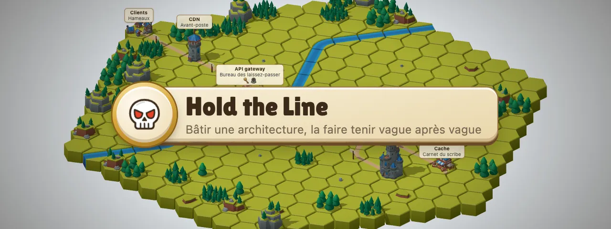
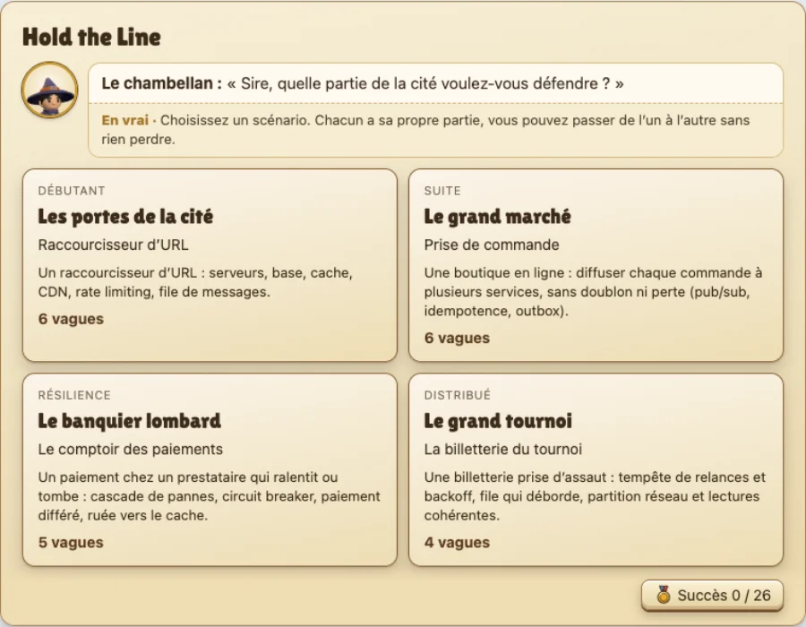
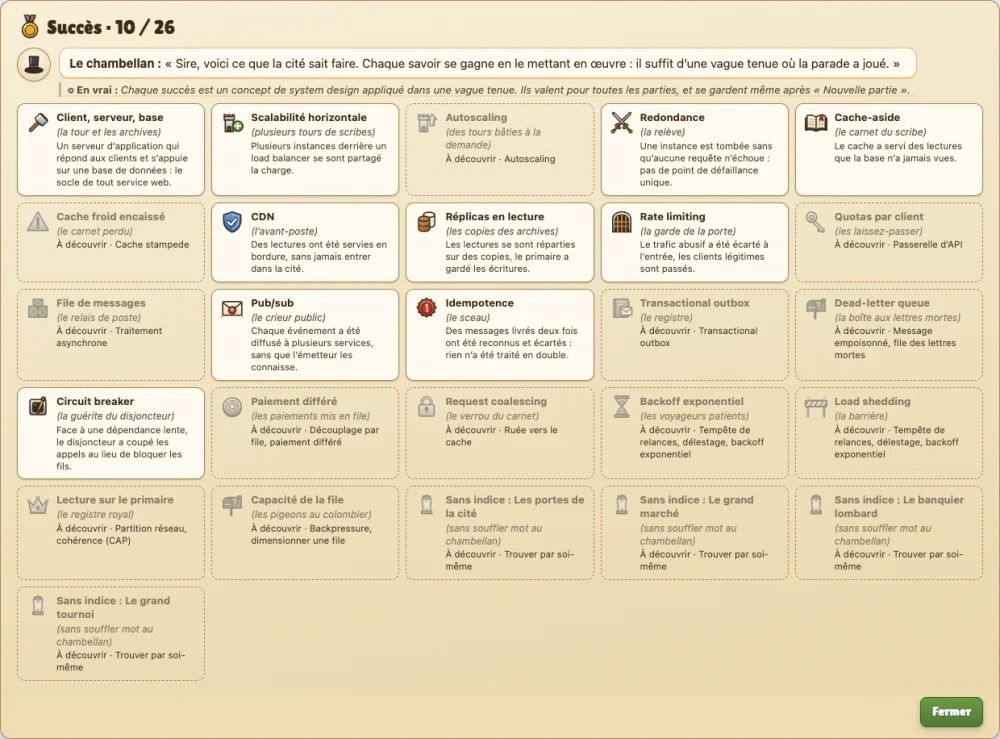

<div align="center">



<br>

**Un jeu pour apprendre le system design.**<br>
On bâtit une architecture distribuée sur un plateau, puis on la fait tenir, vague après vague.

<br>

<a href="https://fgeronimi.github.io/hold-the-line/"></a>

<sub>Gratuit, sans inscription, dans le navigateur · 4 scénarios · 21 vagues · 26 succès</sub>

<br><br>

[Le principe](#le-principe) · [Comment on joue](#comment-on-joue) · [En images](#en-images) · [Développement](#développement) · [Crédits](#crédits)

</div>

<br>


## Le principe

Chaque vague amène une nouvelle contrainte : plus de lectures, un pic de trafic, un client
abusif, un prestataire qui tombe. Il faut adapter le système sans tout casser, en
arbitrant entre **coût**, **complexité** et **fiabilité**. Le moteur simule vraiment le
trafic, minute par minute : la file s'allonge, la base sature, le SLA rompt.

Tout est raconté comme une cité médiévale, pour se représenter le système ; mais le nom
technique vient toujours en premier, et chaque réplique du chambellan, le narrateur, est
suivie de la même chose **« en vrai »**.

<div align="center">

</div>

| Scénario | Niveau | Ce qu'on y apprend |
|---|---|---|
| **Les portes de la cité** · un raccourcisseur d'URL | Débutant | serveur et base, cache, CDN, réplicas, scalabilité horizontale, rate limiting, passerelle d'API, file de messages |
| **Le grand marché** · une prise de commande | Suite | pub/sub, idempotence, transactional outbox, file des lettres mortes |
| **Le banquier lombard** · un paiement chez un prestataire | Résilience | cascade de pannes, circuit breaker, paiement différé, ruée vers le cache |
| **Le grand tournoi** · une billetterie prise d'assaut | Distribué | tempête de relances et backoff, load shedding, file qui déborde, partition réseau |

<details>
<summary><b>La cité, en vrai</b> : ce que chaque bâtiment représente</summary>

<br>

| Dans l'architecture | Dans la cité |
|---|---|
| Clients | Hameaux |
| CDN | Avant-poste |
| Load balancer, et son rate limiting | Porte de la cité, et sa garde |
| API gateway | Bureau des laissez-passer |
| Application server, une tour par instance | Tours des scribes |
| Worker | Tour des commis |
| Cache (cache-aside) | Carnet du scribe |
| Database, et ses réplicas en lecture | Archives royales, et leurs copies |
| Message queue | Relais de poste |
| Pub/sub | Crieur public, au clocher |
| Services métier (stock, facturation, e-mail) | Magasinier, Trésorier, Messager |
| Prestataire de paiement, d'e-mail | Banquier lombard, colombier |
| Lectures, écritures, tâches async | Messagers, porteurs, mages |
| Trafic abusif (scraper) | Pillards squelettes |

</details>

## Comment on joue

| | |
|---|---|
| **1. Le briefing** | Le chambellan annonce la vague : trafic, budget, plafond de complexité, SLA, et l'incident prévu (un cache qui redémarre à froid, une instance qui tombe). |
| **2. La construction** | On tire un bâtiment de la main de cartes, on le pose sur le plateau hexagonal, on le relie, on règle ses évolutions. Démolir ne coûte rien. La première vague est guidée pas à pas. |
| **3. La vague** | En direct : chaque requête fait l'aller-retour depuis les hameaux. Un bandeau signale les goulots et les incidents. |
| **4. Le debrief** | Ce qui a tenu, chiffré ; ce qui a failli casser, et pourquoi ; la parade ; ce qu'on pourrait alléger. Une courbe par bâtiment, minute par minute. |

**Trois étoiles par vague** : la tenir, sans rien de superflu, en restant économe. Perdre ne
coûte rien : on recommence jusqu'aux trois étoiles, et une vague déjà tenue se rejoue sans
effacer la suite. Un indice s'ouvre à chaque essai perdu.

**Des succès** : chaque concept appliqué dans une vague tenue en débloque un, du cache au
circuit breaker. Ils valent pour toutes les parties.

<div align="center">

</div>

## En images

<table>
<tr>
<td width="50%"></td>
<td width="50%"></td>
</tr>
<tr>
<td><b>La construction guidée.</b> La main de cartes, la pose de la tour, le chemin tracé depuis les hameaux.</td>
<td><b>Une vague perdue.</b> La base sature : les bords rougissent, la cloche sonne, le SLA est rompu.</td>
</tr>
</table>

<div align="center">

<br><sub><b>Le debrief du chambellan</b> : les étoiles, les succès débloqués, ce qui a tenu et pourquoi.</sub>
</div>

<details>
<summary><b>La vitrine des effets</b> : chaque incident, seul sur un îlot de démonstration</summary>

<br>

|  |  |  |
|---|---|---|
| **Saturation** · la charge dépasse 100 % | **Requête refusée** · au-delà de la capacité | **Arriéré de file** · la file s'allonge |
|  |  |  |
| **Appel trop lent** · p95 au-delà du SLA | **Message livré deux fois** · sans idempotence | **Événement perdu** · sans outbox |
|  |  |  |
| **Panne d'instance** · un SPOF qui tombe | **Pillards repoussés** · rate limiting | **Cascade de pannes** · fils d'exécution saturés |
|  |  |  |
| **Circuit coupé** · circuit breaker | **Tempête de relances** · retries sans backoff | **Partition réseau** · lectures périmées |
|  |  |  |
| **Message empoisonné** · sans file des lettres mortes | **Pastilles d'évolution** · acheter une évolution | **Autoscaling** · le délai de démarrage |
|  |  |  |
| **Guérite du disjoncteur** · l'état demi-ouvert | **Verrou de recalcul** · request coalescing | **SLA franchi** · la vague est perdue |

`npm run dev`, puis `/vitrine.html`.

</details>

<details>
<summary><b>La planche de design</b> : pictogrammes, boutons et barres, en SVG et CSS, sans une seule image</summary>

<br>


`npm run dev`, puis `/design.html`.

</details>

## Développement

```bash
npm install
npm run dev        # le jeu en local
npm test           # tests (Vitest)
npm run typecheck  # TypeScript
npm run balance    # simulation en masse : l'équilibrage des vagues (~6 min)
npm run balance:check  # compare l'équilibrage à docs/balance-snapshot.txt
npm run build      # site statique dans dist/
npm run captures   # refait les images animées de ce README (docs/media/)
```

Le moteur de simulation (`src/engine/`) est pur, déterministe et sans DOM : un modèle de
flux par ticks. Scénarios, composants, leçons et thème sont des données (`src/data/`).
Le rendu (`src/render/`) ne simule rien, il affiche les ticks calculés par le moteur.
Les décisions de design, avec leur pourquoi, sont dans
[`docs/decisions.md`](docs/decisions.md).

Chaque push sur `main` lance les tests puis publie sur GitHub Pages ; l'équilibrage a son
propre workflow, quand le moteur ou les données changent.

Mode debug (calibrage, vue tableau, essais hors partie) : `?debug` dans l'URL, ou la touche D.

## Crédits

<details>
<summary>Modèles 3D, bibliothèques, polices</summary>

<br>

**Modèles 3D**

Tous de **Kay Lousberg** ([kaylousberg.com](https://kaylousberg.com)), sous licence
[CC0 1.0](https://creativecommons.org/publicdomain/zero/1.0/) : le crédit n'est pas
obligatoire, on le donne quand même. Seuls les modèles utilisés sont copiés dans le dépôt.

- [**KayKit Medieval Hexagon Pack 1.0**](https://github.com/KayKit-Game-Assets/KayKit-Medieval-Hexagon-Pack-1.0) :
  tuiles d'herbe, de route et de rivière, gués et pont, bâtiments (maisons, puits, tours,
  caserne, château, marché, taverne, église, porte fortifiée), arbres, rochers, collines et
  montagnes, caisses, sacs, barrières, drapeaux.
- [**KayKit Character Pack : Adventurers 1.0**](https://github.com/KayKit-Game-Assets/KayKit-Character-Pack-Adventures-1.0) :
  Rogue, Barbarian et Mage, les requêtes.
- [**KayKit Character Pack : Skeletons 1.0**](https://github.com/KayKit-Game-Assets/KayKit-Character-Pack-Skeletons-1.0) :
  Skeleton Warrior, le trafic abusif.

Les personnages sont allégés par `scripts/strip-characters.mjs`. Détail des fichiers et
des licences : [`public/models/CREDITS.md`](public/models/CREDITS.md).

**Bibliothèques**

- [Three.js](https://threejs.org) (MIT) : le plateau 3D, le chargement glTF, les
  contrôles de caméra et les étiquettes.
- [glTF Transform](https://gltf-transform.dev) (MIT) : l'allègement des personnages, en
  développement seulement.
- [TypeScript](https://www.typescriptlang.org) (Apache 2.0),
  [Vite](https://vite.dev) (MIT) et [Vitest](https://vitest.dev) (MIT) : le langage, le
  build et les tests.

Les pictogrammes sont dessinés pour le jeu, en SVG (`src/ui/sprite.ts`). Titrage :
[Lilita One](https://fonts.google.com/specimen/Lilita+One) (SIL Open Font License), copiée
dans le dépôt. Aucune autre ressource externe.

**Contenu**

Le jeu prolonge le calendrier
[Advent of System Design](https://github.com/fgeronimi/advent-of-system-design), dont les
fiches seront reprises dans le jeu.

</details>

## Licence

- Le code : [MIT](LICENSE).
- Le contenu pédagogique (leçons, scénarios, récits, documentation) :
  [CC BY 4.0](LICENSE-CONTENT.md).
- Les modèles 3D : CC0, comme publiés par leur auteur.
