# Hold the Line

Un jeu de construction et de défense pour comprendre le **system design** : on bâtit une
architecture distribuée sur un plateau, puis on la fait tenir vague après vague. Chaque
vague amène une nouvelle contrainte (plus de lectures, un pic de trafic, un client abusif,
des clics à compter) : il faut adapter le système sans tout casser, en arbitrant entre
coût, complexité et fiabilité.

**Jouer : https://fgeronimi.github.io/hold-the-line/**

## Le principe

Quatre scénarios, au choix dès le lancement : *Les portes de la cité*, un raccourcisseur
d'URL (serveurs, base, cache, CDN, rate limiting, file de messages) ; *Le grand marché*,
la prise de commande d'une boutique en ligne (pub/sub, idempotence, outbox) ; *Le
banquier lombard*, un paiement chez un prestataire qui ralentit ou tombe (cascade de
pannes, circuit breaker, paiement différé, ruée vers le cache) ; et *Le grand tournoi*,
une billetterie prise d'assaut (tempête de relances et backoff, file qui déborde,
partition réseau et lectures cohérentes). Tous sont racontés comme
une cité médiévale. La métaphore aide à se représenter le système ; le vrai nom
technique vient toujours en premier.

| Dans l'architecture | Dans la cité |
|---|---|
| Clients | Hameaux |
| CDN | Avant-poste |
| Load balancer, et son rate limiting | Porte de la cité, et sa garde |
| Application server, une tour par instance | Tours des scribes |
| Cache (cache-aside) | Carnet du scribe |
| Database, et ses réplicas en lecture | Archives royales, et leurs copies |
| Message queue | Relais de poste |
| Pub/sub | Crieur public, au clocher |
| Services métier (stock, facturation, e-mail) | Magasinier, Trésorier, Messager |
| Prestataire de paiement externe | Banquier lombard |
| Lectures, écritures, tâches async | Messagers, porteurs, mages |
| Trafic abusif (scraper) | Pillards squelettes |

Chaque réplique du chambellan, le narrateur, est suivie de la même chose « en vrai »,
avec les termes techniques. Chaque bâtiment dit à quoi il sert, dans les deux langues.

## Comment on joue

1. **Le briefing** : le chambellan annonce la vague (trafic, budget, plafond de
   complexité, SLA) et l'éventuel incident prévu (un cache qui redémarre à froid, une
   instance qui tombe).
2. **La construction** sur le plateau hexagonal : poser des bâtiments (une carte de la
   main, puis sa case), les déplacer en les glissant, les relier (clic sur le départ, puis
   sur l'arrivée), régler leurs évolutions dans leur fiche ; annuler avec ⌘Z. Une
   rivière traverse le plateau : on ne bâtit pas dessus, les chemins la franchissent par
   un pont. La première vague est guidée pas à pas.
3. **La vague**, en direct : chaque requête fait l'aller-retour depuis les hameaux, +1
   quand la réponse revient, −1 là où elle est refusée. Un bandeau signale les goulots et
   les incidents.
4. **Le debrief** : ce qui a marché (la part de chaque bâtiment, chiffrée), ce qui a failli
   casser et pourquoi, la parade, et ce qu'on pourrait alléger. Trois étoiles par vague :
   la tenir, du premier coup, en restant économe. Une vague perdue se rejoue ; le menu
   permet de revenir à une vague antérieure.

Mode debug (calibrage, vue tableau, essais hors partie) : ajouter `?debug` à l'URL, ou
touche D.

## En images

Captures du jeu tel qu'il tourne, rejeux accélérés.

**La construction guidée de la vague 1.** Le reflet signale le prochain geste, la main de
cartes se distribue, une carte se soulève au survol ; on pose la tour, puis on trace son
chemin depuis les hameaux.

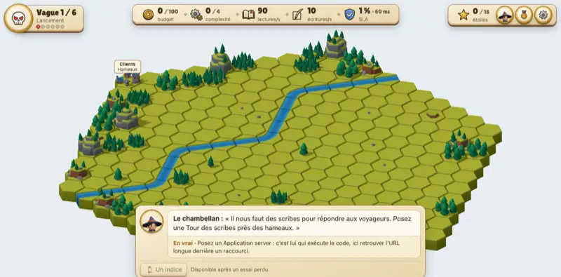

**Une vague tenue, avec son incident.** Les voyageurs font l'aller-retour, les compteurs
montent ; à la 46ᵉ minute une instance du serveur tombe, la caméra s'approche, la tour
s'embrase.

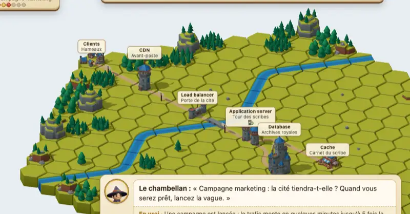

**Une vague perdue.** La base sature dès la 5ᵉ minute : les bords de l'écran rougissent,
la cloche sonne, la bannière « SLA rompu » tombe.

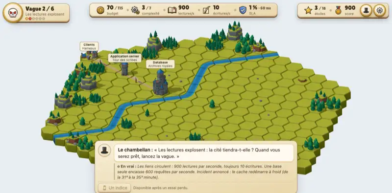

**Le debrief du chambellan** : ce qui a tenu, chiffré, ce qui a failli casser, la parade.

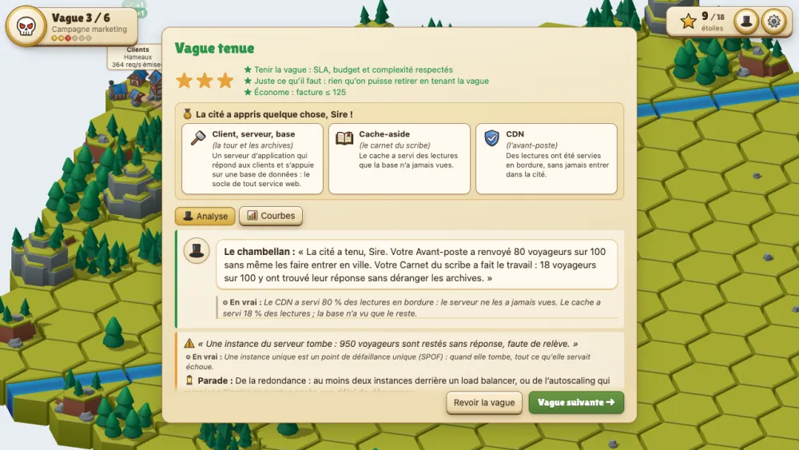

### La vitrine des effets

Chaque incident a son effet sur le plateau, montré seul sur un îlot de démonstration
(`npm run dev`, puis `/vitrine.html`).

| 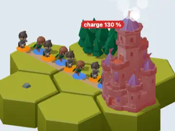 | 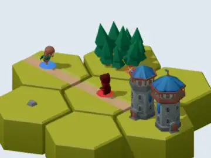 | 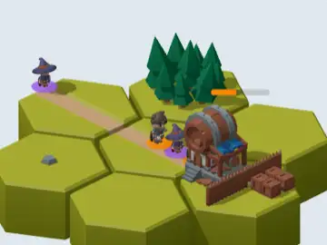 |
|---|---|---|
| **Saturation** · la charge dépasse 100 % | **Requête refusée** · au-delà de la capacité | **Arriéré de file** · la file s'allonge |
| 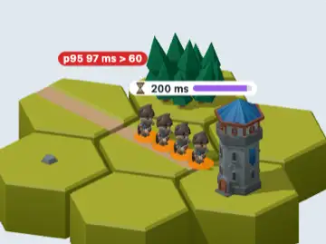 | 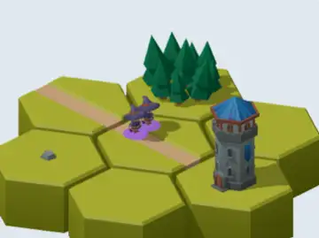 | 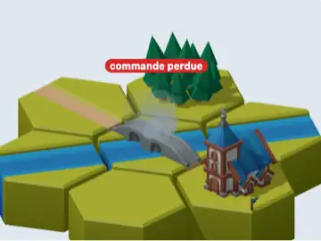 |
| **Appel trop lent** · p95 au-delà du SLA | **Message livré deux fois** · sans idempotence | **Événement perdu** · sans outbox |
| 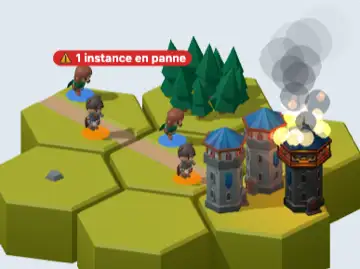 | 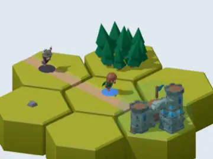 | 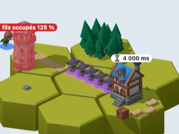 |
| **Panne d'instance** · un SPOF qui tombe | **Pillards repoussés** · rate limiting | **Cascade de pannes** · fils d'exécution saturés |
| 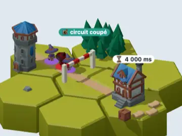 | 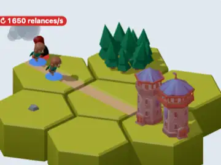 | 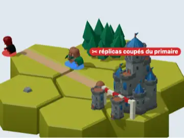 |
| **Circuit coupé** · circuit breaker | **Tempête de relances** · retries sans backoff | **Partition réseau** · lectures périmées |
| 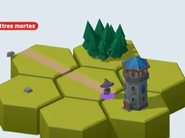 | 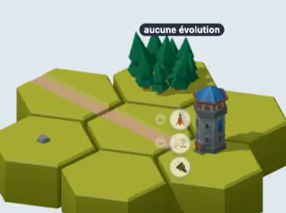 | 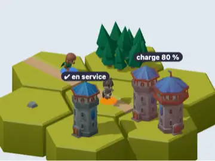 |
| **Message empoisonné** · sans file des lettres mortes | **Pastilles d'évolution** · acheter une évolution | **Autoscaling** · le délai de démarrage |
| 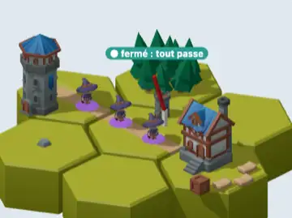 | 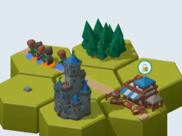 | 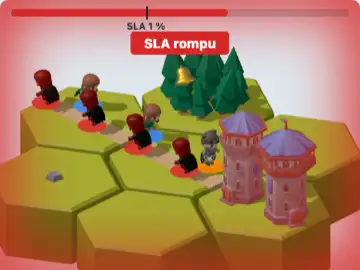 |
| **Guérite du disjoncteur** · l'état demi-ouvert | **Verrou de recalcul** · request coalescing (maquette) | **SLA franchi** · la vague est perdue |

### La planche de design

Pictogrammes, médaillons et rubans dessinés en SVG et en CSS, sans une seule image
(`npm run dev`, puis `/design.html`).

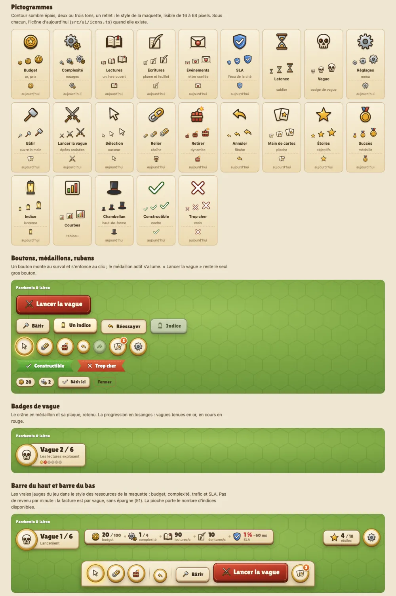

## Développement

```bash
npm install
npm run dev        # le jeu en local
npm test           # tests (Vitest)
npm run typecheck  # TypeScript
npm run balance    # simulation en masse : l'équilibrage des vagues (~6 min)
npm run balance:check  # compare l'équilibrage à docs/balance-snapshot.txt
npm run build      # site statique dans dist/
npm run captures   # refait les images animées de ce README (docs/media/)
```

Le moteur de simulation (`src/engine/`) est pur, déterministe et sans DOM : un modèle de
flux par ticks. Scénarios, composants, leçons et thème sont des données (`src/data/`).
Le rendu (`src/render/`) ne simule rien, il affiche les ticks calculés par le moteur.
Les décisions de design, avec leur pourquoi, sont dans
[`docs/decisions.md`](docs/decisions.md).

Chaque push sur `main` lance les tests puis publie sur GitHub Pages ; l'équilibrage a son
propre workflow, quand le moteur ou les données changent.

## Ressources utilisées

### Modèles 3D

Tous de **Kay Lousberg** ([kaylousberg.com](https://kaylousberg.com)), sous licence
[CC0 1.0](https://creativecommons.org/publicdomain/zero/1.0/) : le crédit n'est pas
obligatoire, on le donne quand même. Seuls les modèles utilisés sont copiés dans le dépôt.

- [**KayKit Medieval Hexagon Pack 1.0**](https://github.com/KayKit-Game-Assets/KayKit-Medieval-Hexagon-Pack-1.0) :
  tuiles d'herbe, de route et de rivière, gués et pont, bâtiments (maisons, puits, tours,
  caserne, château, marché, taverne, église, porte fortifiée), arbres, rochers, collines et
  montagnes, caisses, sacs, barrières, drapeaux.
- [**KayKit Character Pack : Adventurers 1.0**](https://github.com/KayKit-Game-Assets/KayKit-Character-Pack-Adventures-1.0) :
  Rogue, Barbarian et Mage, les requêtes.
- [**KayKit Character Pack : Skeletons 1.0**](https://github.com/KayKit-Game-Assets/KayKit-Character-Pack-Skeletons-1.0) :
  Skeleton Warrior, le trafic abusif.

Les personnages sont allégés par `scripts/strip-characters.mjs`. Détail des fichiers et
des licences : [`public/models/CREDITS.md`](public/models/CREDITS.md).

### Bibliothèques

- [Three.js](https://threejs.org) (MIT) : le plateau 3D, le chargement glTF, les
  contrôles de caméra et les étiquettes.
- [glTF Transform](https://gltf-transform.dev) (MIT) : l'allègement des personnages, en
  développement seulement.
- [TypeScript](https://www.typescriptlang.org) (Apache 2.0),
  [Vite](https://vite.dev) (MIT) et [Vitest](https://vitest.dev) (MIT) : le langage, le
  build et les tests.

Les pictogrammes sont dessinés pour le jeu, en SVG (`src/ui/sprite.ts`). Titrage :
[Lilita One](https://fonts.google.com/specimen/Lilita+One) (SIL Open Font License), copiée
dans le dépôt. Aucune autre ressource externe.

### Contenu

Le jeu prolonge le calendrier
[Advent of System Design](https://github.com/fgeronimi/advent-of-system-design), dont les
fiches seront reprises dans le jeu.

## Licence

- Le code : [MIT](LICENSE).
- Le contenu pédagogique (leçons, scénarios, récits, documentation) :
  [CC BY 4.0](LICENSE-CONTENT.md).
- Les modèles 3D : CC0, comme publiés par leur auteur.
